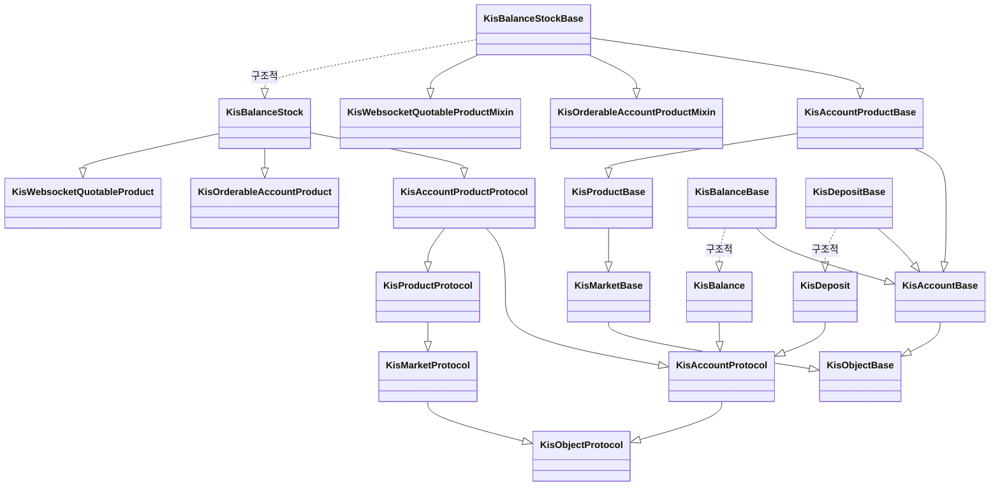
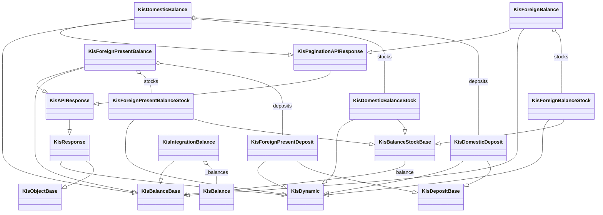

# 잔고 클래스 다이어그램

`src/vmkis/api/account/balance.py` 의 상속과 조립입니다. 호출자가 실제로 무엇을 받는지, 모의투자에서 종목만 갈아 끼우는지는 [BALANCE_CLASSES.md](BALANCE_CLASSES.md) 에 있습니다.

프로토콜 만족은 구조적입니다. `Checkable[KisBalanceStock]` 은 종목 구현 세 개에만 붙어 있습니다. 잔고·예수금은 베이스가 프로토콜과 같은 멤버를 가지는 것으로 맞춥니다.

생성은 `@dataclass` 가 아닙니다. 종목·예수금은 `KisObject.transform_` 가 빈 인스턴스를 만든 뒤 필드를 채우고, 잔고 객체는 각 `__init__` 이 계좌번호(와 국가)를 받습니다.

## 프로토콜과 베이스

`KisBalanceStock` 만 주문·웹소켓 믹스인을 탑니다. 잔고와 예수금은 계좌 프로토콜입니다.

실선은 클래스 상속입니다. 점선은 프로토콜을 멤버로 만족한다는 뜻이고, 베이스가 프로토콜을 상속하지는 않습니다. 믹스인도 프로토콜을 상속하지 않습니다. `KisOrderableAccountProductMixin` 은 `buy` / `sell` / `order` 를, `KisWebsocketQuotableProductMixin` 은 `on` 을 클래스 본문에서 붙입니다.

## 구현과 조립

국내 잔고와 해외 잔고(모의투자 종목 원천)는 페이지 응답입니다. 해외 체결기준현재잔고는 페이지가 없는 API 응답입니다. 통합 잔고는 응답 파서가 아니고, 이미 만든 잔고를 이어 붙입니다.

`balance` 는 만든 뒤 종목의 `balance` 를 잔고 자신으로 다시 씁니다. 통합 잔고는 넘긴 잔고들의 `stocks` 와 `deposits` 를 자기 필드로 모으면서, 종목의 `balance` 를 통합 잔고로 바꿉니다.

`KisForeignBalance.deposits` 는 생성자에서 빈 dict 입니다. 해외 예수금 구현은 `KisForeignPresentDeposit` 입니다.
